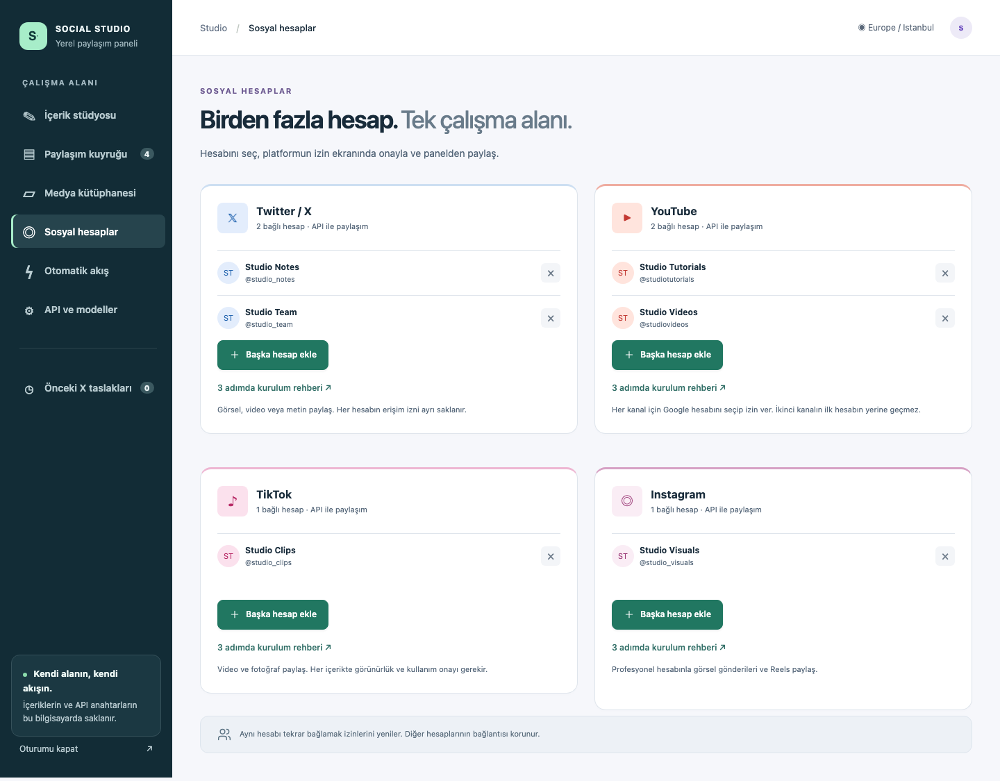
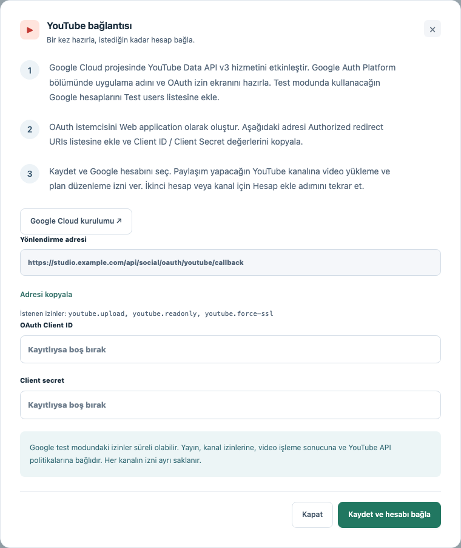
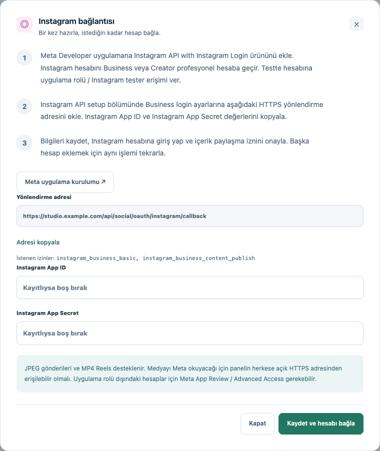
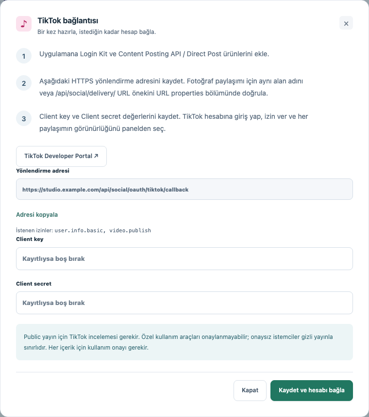

# Sosyal hesapları API ile bağlama

[Başlangıç rehberi](quick-start-tr.md) · [English README](../README.md)

Bu rehber, geliştirici uygulaması oluşturmaktan hesabını panelde görmeye kadar bütün bağlantı adımlarını açıklar. Her platform için bir geliştirici uygulaması hazırlarsın; aynı platformdaki diğer hesaplarını bu uygulamayla ayrı ayrı bağlarsın. Her hesap için yeniden geliştirici uygulaması oluşturman gerekmez.

Doğrudan git: [YouTube](#youtube-birden-fazla-hesap-veya-kanal) · [Instagram](#instagram-gönderi-ve-reels) · [TikTok](#tiktok-video-ve-fotoğraf) · [HTTPS kurulumu](#instagram-ve-tiktok-fotoğrafları-için-herkese-açık-https) · [Bağlantı sorunları](#bağlantı-sorunları)

*Görseller, gerçek Social Studio arayüzünden örnek hesaplarla alınmıştır. Gerçek hesap veya anahtar içermez. Görsele tıklayarak tam boyutunu açabilirsin. Yeni hesap için **Başka hesap ekle**, bağlantı ayarları için **3 adımda kurulum rehberi** düğmesini kullan.*

## Başlamadan önce

Önce panelin yerel ilk kurulumunu tamamla ve bir panel şifresi belirle. Sonra **Sosyal hesaplar > ilgili platform > Bağlantıyı hazırla** düğmesini aç. Bağlantıyı önceden hazırladıysan **3 adımda kurulum rehberi** düğmesini kullan.

| Ekranda göreceğin terim | Ne anlama geliyor? |
| --- | --- |
| OAuth | Google, Instagram veya TikTok'un kendi ekranında hesabını seçip uygulamaya izin vermen |
| Redirect URI / callback / yönlendirme adresi | İzin verdikten sonra platformun seni panele geri gönderdiği adres |
| Client ID / Client key ve Client secret | Geliştirici uygulamanı tanıtan bilgiler; sosyal medya şifren değildir |
| Scope / permission | Video yükleme gibi belirli bir işlem için istenen izin |
| Sandbox / Testing | Platformun sınırlı deneme ortamı; herkese açık yayın onayı anlamına gelmez |

**Yönlendirme adresini paneldeki Adresi kopyala düğmesiyle al.** Aşağıdaki adresler örnektir. `localhost` ile `127.0.0.1`, farklı portlar, `http` ile `https` ve sondaki fazladan `/` aynı adres değildir. Sağlayıcıya panelin gösterdiği adresi aynen kaydet.

YouTube yerel `http://localhost:3000` adresinde bağlanabilir. Bu projenin Instagram ve TikTok bağlantıları HTTPS adresi kullanır. Henüz böyle bir adresin yoksa önce [HTTPS kurulumunu](#instagram-ve-tiktok-fotoğrafları-için-herkese-açık-https) tamamla. Instagram için hazırladığın HTTPS adresini TikTok ve YouTube için de kullanabilirsin.

Sosyal medya şifreni panele girmezsin; platformun kendi sayfasında giriş yaparsın. Erişim token'larını elle oluşturman gerekmez, uygulama bunları alır ve yeniler. API bilgilerini daha sonra **API ve modeller** sayfasından değiştirebilirsin. Boş alan mevcut değeri korur; geliştirici uygulamasını değiştirirsen o platformun hesaplarını yeniden bağlaman gerekir.

| Platform | Panelden paylaşım | Gereken hesap / erişim |
| --- | --- | --- |
| X | Metin, tek görsel veya MP4 video | Yazma ve medya yüklemeye izin veren API erişimi |
| YouTube | MP4 video, başlık, açıklama, isteğe bağlı JPEG/PNG kapak | YouTube kanalı ve Google OAuth izni |
| Instagram | Tek JPEG gönderisi veya MP4 Reels | Business / Creator hesabı, Instagram Login ve paylaşım izni |
| TikTok | MP4 video veya tek JPEG/WebP fotoğraf | Login Kit, Content Posting API ve hesap başına izin |

## YouTube: birden fazla hesap veya kanal

Yönetebildiğin bir YouTube kanalı olan Google hesabı gerekiyor. Aynı Google Cloud projesi ve OAuth istemcisiyle birden fazla kanal bağlayabilirsin.

*Bu, Social Studio içindeki YouTube kurulum ekranıdır. Resimdeki örnek adresi kullanma; kendi panelinden kopyala. Google Cloud'da oluşturacağın iki bilgiyi burada gösterilen alanlara gireceksin.*

1. **Google Cloud projesi oluştur.** [Google Cloud Console](https://console.cloud.google.com/) sayfasını aç. Üstteki proje seçicisinden yeni proje oluştur veya mevcut projeni seç. Örneğin `Social Studio` adını verebilirsin. Sonraki adımlarda aynı proje seçili kalsın.
2. **YouTube API'sini aç.** [YouTube Data API v3](https://console.cloud.google.com/apis/library/youtube.googleapis.com) sayfasında **Enable / Etkinleştir** düğmesine bas.
3. **İzin ekranını hazırla.** **Google Auth Platform > Branding** bölümünü aç. İlk kurulumsa **Get Started** ile başla. Uygulama adını, destek e-postasını ve iletişim e-postasını gir. Kişisel Gmail hesapları için **Audience > External** seç. Uygulama **Testing** durumundayken **Audience > Test users > Add users** bölümüne kullanacağın Google hesaplarının e-posta adreslerini ekle. [Google izin ekranı rehberi](https://developers.google.com/workspace/guides/configure-oauth-consent)
4. **İzinleri ekle.** **Data Access > Add or Remove Scopes** bölümüne aşağıdaki üç izni ekle ve kaydet. Aramada çıkmazsa tam adreslerini elle gir.

   | İzin | Panelde ne için kullanılıyor? |
   | --- | --- |
   | `https://www.googleapis.com/auth/youtube.readonly` | Bağlanan kanalı ve video durumunu okuma |
   | `https://www.googleapis.com/auth/youtube.upload` | Seçtiğin videoyu yükleme |
   | `https://www.googleapis.com/auth/youtube.force-ssl` | Yüklenmiş videonun yayın planını değiştirme veya iptal etme; Google'daki bu izin başka video, yorum ve altyazı işlemlerini de kapsar |

5. **OAuth istemcisi oluştur.** **Clients > Create client > Web application** seç ve bir ad ver. **Authorized redirect URIs** alanına panelin **Sosyal hesaplar > YouTube > Bağlantıyı hazırla** bölümündeki adresi yapıştır. Yerel örnek: `http://localhost:3000/api/social/oauth/youtube/callback`. HTTPS kullanıyorsan paneldeki HTTPS adresini kopyala. Bu sunucu bağlantısı için **Authorized JavaScript origins** doldurman gerekmiyor.
6. **Bilgileri panele gir.** Oluşturulan **Client ID** değerini paneldeki **OAuth Client ID**, **Client secret** değerini **Client secret** alanına yapıştır. Google API key veya service account JSON dosyası bu bilgilerin yerine geçmez. [Google Web OAuth rehberi](https://developers.google.com/identity/protocols/oauth2/web-server)
7. **Kanalı bağla.** **Kaydet ve hesabı bağla** düğmesine bas. Google ekranında yayın yapacağın hesabı ve sunuluyorsa ilgili YouTube / marka kanalını seç. İstenen izinlerin tamamını kontrol edip onayla. Panele dönünce doğru kanal adının **Sosyal hesaplar** altında göründüğünü kontrol et.
8. **İkinci kanalı ekle.** **YouTube > Başka hesap ekle** düğmesine bas ve diğer hesap/kanalla izin adımını tekrarla. Aynı client bilgilerini kullan. İlk kanalın izni korunur; aynı kanalı yeniden bağlamak sadece o kanalın iznini yeniler.

**İlk kontrol:** **İçerik stüdyosu** sayfasında kanalı seç, kısa bir MP4 ekle ve başlık, açıklama, görünürlüğü kontrol et. İlk yüklemeyi gizli görünürlükle deneyebilirsin. Daha sonra **Yayın zamanı > Tarih ve saat seç > YouTube’a yükle ve planla** ile gelecekte herkese açık yayın planlayabilirsin. [Zamanlama ayrıntıları](#tarih-ve-saatle-zamanlama).

Eski bir bağlantıyla plan düzenleme izni hatası alırsan aynı kanalı yeniden bağla. Özel kapak yükleyebilmek için kanalın bu özelliğe erişimi de olmalı. Video başarıyla yüklenir ama kapak reddedilirse panel ikinci bir video yüklemez; mevcut video sonucunu ve kapak hatasını gösterir.

**Testing ve Production farkı:** Bu panelin istediği izinlerle, **External / Testing** durumunda verilen yenileme token'ı yedi günde sona erer. Gerektiğinde hesabı tekrar bağla veya uygulamayı Production'a geçirip Google'ın kullanımına ve izinlerine göre istediği doğrulamaları tamamla. Production, iznin hiçbir zaman sona ermeyeceği anlamına gelmez. [Google token süreleri](https://developers.google.com/identity/protocols/oauth2#expiration)

## Instagram: gönderi ve Reels

**Business** veya **Creator** profesyonel hesabı gerekiyor. Panelimiz **Instagram API with Instagram Login** kullanır. Bu yöntem Facebook Sayfası bağlamanı gerektirmez. Önce [HTTPS kurulumunu](#instagram-ve-tiktok-fotoğrafları-için-herkese-açık-https) tamamla; Meta hem görseli hem Reels videosunu buradan indirecek.

*Buradaki iki alana Meta'nın **Instagram Login** ürününe ait bilgileri gireceksin. Görseldeki alan adı örnektir; kendi panelinde gösterilen HTTPS adresini kullan.*

1. **Instagram hesabını hazırla.** Instagram ayarlarında hesap türü / profesyonel hesap bölümünü bul. Gerekiyorsa hesabını **Business** veya **Creator** türüne geçir. Bağlayacağın her hesap için bunu kontrol et.
2. **Meta uygulamasını oluştur.** [Meta Developers](https://developers.facebook.com/apps/) sayfasında **Create App** seç. Uygulama adı ve iletişim bilgilerini doldur. **Instagram API with Instagram Login** sağlayan Instagram kullanım senaryosunu / ürününü seç. Uygulama türü sorulursa bu ürünü destekleyen türü, genellikle **Business**, seç. Meta'nın menü adları uygulama yapılandırmasına göre değişebilir.
3. **Test hesabını ekle.** Geliştirme sırasında Instagram ürününün test hesapları veya **App roles / Instagram Tester** bölümünden kullanacağın Instagram hesabını ekle. O Instagram hesabına giriş yapıp uygulama/site izinleri bölümündeki tester davetini varsa kabul et. Yalnızca davet göndermek izin vermeye yetmeyebilir.
4. **Dönüş adresini kaydet.** Instagram ürününün **API setup / Business login** ayarlarına paneldeki **Sosyal hesaplar > Instagram > Bağlantıyı hazırla** bölümünden kopyaladığın HTTPS adresini ekle. Örnek: `https://studio.example.com/api/social/oauth/instagram/callback`. İstenirse web sitesi, gizlilik politikası ve veri silme bilgilerini uygulamanın gerçek bilgileriyle tamamla.
5. **İzinleri kontrol et.** Panelin istediği izinler `instagram_business_basic` ve `instagram_business_content_publish`. Bunlar profesyonel hesap bağlantısı ve içerik paylaşımı içindir. Ürünün Instagram Login olduğundan ve izin adlarının eşleştiğinden emin ol. [Meta'nın resmi API örnekleri](https://www.postman.com/meta/instagram/folder/1z5vxzu/instagram-api-with-instagram-login)
6. **Instagram bilgilerini panele gir.** Instagram ürünündeki **Instagram App ID** ve **Instagram App Secret** değerlerini paneldeki aynı adlı alanlara yapıştır. Başka bir Facebook Login istemcisinin bilgilerini kullanma. **Kaydet ve hesabı bağla** düğmesine bas.
7. **Hesaba izin ver.** Instagram ekranında doğru hesaba giriş yap ve istenen izinleri onayla. Dönüşte **Sosyal hesaplar** altında hesabın adını kontrol et. İkinci profesyonel hesabı **Instagram > Başka hesap ekle** ile aynı şekilde bağla. Her hesabın izni ayrı saklanır.

**İlk paylaşım:** İçerik stüdyosunda Instagram taslağını aç ve hesabını seç:

- **Gönderi** için JPEG görsel seç.
- **Reels** için MP4 video seç. **Reels profil akışında da görünsün** seçeneğini düzenle.
- İngilizce metni kontrol edip **Şimdi paylaş** veya **Tarih ve saat seç > Onayla ve planla** kullan.

Panel medyayı hazırlar, Meta'nın işleme sonucunu bekler ve sonra yayınlar. Uzun süreli izinler, süreleri dolmadan son yedi gün içinde kullanım sırasında yenilenir. Süresi tamamen dolmuş izinde hesabı tekrar bağlaman gerekir.

**Test hesaplarının dışına çıkarken:** Uygulama rolü dışındaki hesaplar için **App Review / Advanced Access** ve Meta'nın istediği işletme doğrulaması gerekebilir. Uygulama panelinde gösterilen gereklilikleri tamamla. [Instagram Login rehberi](https://developers.facebook.com/docs/instagram-platform/instagram-api-with-instagram-login/)

## TikTok: video ve fotoğraf

**Herkese açık yayın için başvurmadan önce:** TikTok, yalnızca senin veya ekibinin hesaplarına içerik yüklemeyi amaçlayan özel araçları Direct Post kurallarında uygun kullanım olarak kabul etmiyor. Social Studio kişisel bir paneldir; hesabı bağlamak veya gizli paylaşımı test etmek herkese açık API yayını için onay alacağın anlamına gelmez. [TikTok kullanım kuralları](https://developers.tiktok.com/docs/en/content-sharing-guidelines)

*TikTok'ta uygulama kimliğinin adı **Client key**. Yönlendirme adresini kendi panelinden kopyala, key ve secret bilgilerini gir, ardından **Kaydet ve hesabı bağla** düğmesine bas.*

1. **Geliştirici uygulaması oluştur.** [TikTok Developers](https://developers.tiktok.com/apps/) üzerinde giriş yap. **Manage apps > Connect an app** ile uygulama bilgilerini doldur. Panel Mac'te çalışsa bile mevcut OAuth akışımız için **Web** seç. Gerçek HTTPS web sitesi adresini gir. [Uygulama kayıt rehberi](https://developers.tiktok.com/docs/en/getting-started-create-an-app)
2. **Sandbox oluştur.** Uygulama sayfasında **Sandbox > Create Sandbox** seç. **Sandbox settings > Target users > Add account** yolundan test edeceğin TikTok hesabına giriş yap. Diğer test hesaplarını da ekleyebilirsin; en fazla 10 hedef hesap desteklenir. Listede görünmeleri bir saate kadar sürebilir. Bu işlem herkese açık paylaşım onayı değildir. [Sandbox rehberi](https://developers.tiktok.com/docs/en/add-a-sandbox)
3. **Giriş ve paylaşım ürünlerini ekle.** **Products > Add products** bölümünden **Login Kit** ve **Content Posting API** ekle. Content Posting API içinde **Direct Post** seçeneğini aç. Hesap bilgisi için `user.info.basic`, doğrudan paylaşım için `video.publish` izinlerini tanımla. Paylaşım izni hem uygulamada bulunmalı hem kullanıcı tarafından verilmelidir. [Direct Post kurulumu](https://developers.tiktok.com/docs/en/content-posting-api-get-started)
4. **Yönlendirme adresini ekle.** **Login Kit > Web** ayarlarına panelin **Sosyal hesaplar > TikTok > Bağlantıyı hazırla** bölümünden kopyaladığın adresi yapıştır. Örnek: `https://studio.example.com/api/social/oauth/tiktok/callback`. TikTok Web, HTTPS kullanır; kayıtlı callback adresine sorgu parametresi veya `#` ekleme. Sandbox değişikliklerini **Apply changes** ile kaydet. [Web OAuth rehberi](https://developers.tiktok.com/docs/en/login-kit-web)
5. **Bilgileri panele gir.** Kullandığın ortamın **Credentials** bölümündeki **Client key** ve **Client secret** değerlerini paneldeki aynı adlı alanlara yapıştır. **Kaydet ve hesabı bağla** düğmesine bas, doğru TikTok hesabına giriş yap ve istenen iki izni onayla. Hesabın **Sosyal hesaplar** listesinde görünmeli.
6. **İkinci hesabı bağla.** **TikTok > Başka hesap ekle** düğmesine bas. Aynı geliştirici uygulamasını kullanarak ikinci hesaba izin ver. Tarayıcı otomatik olarak ilk hesabı seçiyorsa TikTok oturumunu ikinci hesaba geçirip tekrar başlat. Sandbox'ta ikinci hesabı önce **Target users** listesine ekle.
7. **Fotoğraf için alan adını doğrula.** TikTok uygulamasındaki **URL properties** bölümünü aç. Medyanın sunulduğu alan adını, tercihen TikTok'un verdiği DNS kaydını alan adının DNS ayarlarına ekleyerek doğrula. Alternatif olarak `https://studio.example.com/api/social/delivery/` URL önekini doğrulayabilirsin; bu yöntem doğrulama dosyası sunmayı gerektirebilir ve panel bunu otomatik yapmaz. Fotoğraf adresi herkese açık HTTPS olmalı ve başka bir adrese yönlenmemeli. Video doğrudan dosya yüklemesi kullanır; fotoğraf bu doğrulanmış adresten indirilir. [Medya doğrulama rehberi](https://developers.tiktok.com/docs/en/content-posting-api-media-transfer-guide)
8. **İlk paylaşımı dene.** **İçerik stüdyosu** sayfasında hesabını ve bir MP4 veya tek JPEG/WebP fotoğrafı seç. **Hesap bilgilerini yenile** düğmesine bas, görünürlüğü seç ve müzik koşullarını onayla. Video için önizleme süresinin yüklenmesini bekle. Ticari içerik / AI bildirimlerini gerektiği gibi seç. Son kontrolün ardından **Şimdi paylaş** veya zamanlama seçeneğini kullan.

**Gizli test koşulları:** İncelemeden geçmeyen istemciler yalnızca **SELF_ONLY / Sadece ben** görünürlüğüyle yayın yapabilir. Paylaşım anında hesabın da gizli olması gerekir. Sandbox'a daha fazla hesap eklenebilse de incelemesiz istemcide 24 saat içinde en fazla beş kullanıcı paylaşım yapabilir. [Test yayın sınırları](https://developers.tiktok.com/docs/en/content-sharing-guidelines)

**Herkese açık yayın başvurusu:** Sandbox ayarlarını **Production > Draft > Import** üzerinden aktar. Web sitesi, gizlilik politikası ve kullanım koşulları adreslerini doğrula. İstenen açıklamayı ve bağlantıdan paylaşıma kadar bütün akışı gösteren demo videoyu hazırlayıp uygulama incelemesine gönder. Gizli yayın kısıtının kaldırılması ayrıca **Direct Post audit** gerektirir. Gerçek kullanım amacını açıklamalısın; yukarıdaki özel araç kısıtı geçerlidir. [Başvuru adımları](https://developers.tiktok.com/docs/en/getting-started-create-an-app), [Direct Post incelemesi](https://developers.tiktok.com/docs/en/content-posting-api-get-started)

Fotoğrafta isteğe bağlı **TikTok önerilen müziği eklesin** seçeneği bulunur. Tek fotoğraf desteklenir. Her gönderi ayrı onaylanır; TikTok tekrarlayan otomatik akışa dahil değildir. Planlanan gönderiler için bilgisayar uyanık, uygulama açık ve internet bağlı olmalı.

## Bağlantı sorunları

| Sorun | Kontrol et |
| --- | --- |
| Redirect / callback uyuşmuyor | Panelden adresi yeniden kopyala. HTTPS/HTTP, alan adı, port, yol ve sondaki `/` birebir eşleşmeli. |
| YouTube test hesabını kabul etmiyor | Doğru Cloud projesinin **Audience > Test users** listesine o Google hesabını ekle. |
| YouTube yaklaşık bir hafta sonra çalışmıyor | External/Testing izni yedi günde sona erer. Hesabı tekrar bağla veya uygun Production kurulumunu tamamla. |
| Instagram hesabı bağlanmıyor | Profesyonel hesap türünü, kabul edilmiş tester davetini, Instagram Login bilgilerini ve paylaşım iznini kontrol et. |
| Instagram veya TikTok medyayı indiremiyor | HTTPS adresi ve imzalı medya yolu erişilebilir olmalı. Proxy giriş ekranı veya tarayıcı doğrulaması indirmeyi engeller. TikTok fotoğraflarında alan adı doğrulaması da gerekir. |
| TikTok herkese açık paylaşımı reddediyor | Sandbox / incelemesiz istemci herkese açık Direct Post yapamaz. Yukarıdaki inceleme koşullarını kontrol et. |
| İkinci hesap yerine ilk hesap yeniden bağlanıyor | Sağlayıcının giriş ekranında / tarayıcı oturumunda hedef hesaba geç, sonra **Başka hesap ekle** işlemini tekrarla. |

## X

[X kurulum rehberini](x-setup.md) kullan. OAuth 2.0 istemcisine okuma, yazma, medya ve çevrimdışı erişim izni ver. Aynı geliştirici uygulamasına birden fazla X hesabı bağlayabilirsin. Metin, görsel ve video yayınları X API üzerinden gider; AI metni İngilizce ve hashtagsiz hazırlar.

## Instagram ve TikTok fotoğrafları için herkese açık HTTPS

Instagram gönderi/Reels ve TikTok fotoğraf API'si dosyayı uygulamadan indirir. `localhost`, yerel ağ IP'si veya özel Tailscale Serve adresi bu sunucular tarafından erişilemez. X, YouTube ve TikTok video yüklemeleri dosyayı doğrudan API'ye gönderir; ancak bu projedeki TikTok Web OAuth bağlantısı için yine HTTPS callback gerekir.

1. İlk sahip kurulumunu yerel adreste tamamla ve güçlü bir panel şifresi kullan.
2. Kendi alan adını ve HTTPS reverse proxy / tünel hizmetini Node sunucuna bağla. Bu hizmet, dışarıdan gelen istekleri bilgisayarındaki uygulamaya iletir. Node dinleyicisini `127.0.0.1` üzerinde tut. Sertifikanın geçerli ve genel olarak güvenilir olması gerekir. TikTok fotoğrafları için sahipliğini doğrulayabileceğin bir alan adı seç.
3. Uygulamayı durdur. Aktif profilin `.env` dosyasında `PUBLIC_BASE_URL=https://studio.example.com` olarak kendi gerçek HTTPS adresini yaz. `HOST=127.0.0.1` ve mevcut `PORT` değeri korunur. Kaynaktan çalıştırırken profil proje klasörüdür; Mac paketinde `~/Library/Application Support/Social Studio/` kullanılır. Yalnızca `.env` değiştirmek alan adı, sertifika veya tünel oluşturmaz.
4. Proxy, aynı alan adını `Host` başlığında korumalı. API POST isteklerini, videoların Range isteklerini ve büyük yüklemeleri geçirmeli. Video işleme sırasında isteğin açık kalabilmesi için proxy yanıt zaman aşımını en az 10 dakika ayarla. Uygulamayı açıp aynı HTTPS adresinden yeniden giriş yap.
5. Sağlayıcıların izin verilen yönlendirme adreslerini panelde yeni gösterilen adreslerle güncelle. Eski OAuth bağlantısını yenilemen gerekebilir.
6. `/api/social/delivery/` yolu ek bir proxy giriş ekranına yönlenmemeli. Sağlayıcıların imzalı dosyayı çerez olmadan okuyabilmesi gerekir. Bu yolun sorgu parametrelerini proxy erişim günlüklerinden çıkar.

Panel yalnızca yayın için seçilen dosyanın bir saat geçerli imzalı bağlantısını üretir. İmza başka dosyada kullanılamaz; süre değiştirildiğinde geçersiz olur. Normal medya önizlemeleri, hesap bilgileri, klasör taraması ve yayın işlemleri sahip oturumu ister. Bu uygulama tek sahip içindir; çok kullanıcılı bir hizmet sunmaz.

## Tarih ve saatle zamanlama

İçerik stüdyosundaki **Yayın zamanı > Tarih ve saat seç** düğmesini kullan. Bütün saatler İstanbul (UTC+3) içindir.

- **YouTube:** En az 5 dakika sonrası seç. **YouTube’a yükle ve planla** videoyu şimdi gizli yükler ve `status.publishAt` değerini YouTube’a kaydeder. Seçilen saatte video herkese açık olur. Yükleme ve plan onaylandıktan sonra bilgisayar kapalı olabilir. İşleme süresi yayını geciktirebilir.
- **X, Instagram ve TikTok:** En az 30 saniye sonrası seçip **Onayla ve planla** düğmesine bas. Kuyruk yereldir; belirlenen saatte bilgisayarın uyanık, uygulamanın açık ve internetin bağlı olması gerekir. Saat kaçırılmışsa uygulama açıldığında gönderilir. TikTok’ta gönderinin görünürlük ve kullanım onayları planlamadan önce tamamlanır.

**Paylaşım kuyruğu > Planlandı** üzerinden saati değiştir veya planı iptal et. YouTube’da aynı video güncellenir; plan iptali videoyu silmez, gizli olarak tutar. YouTube planı uygulama kapandığında veya hesap bağlantısı kesildiğinde devam eder. Aynı kanalı yeniden bağlayıp planı yönetebilirsin. **YouTube durumunu yenile** ile güncel planı ve yayını kontrol et. Yükleme sonrası, uygulama açılışında ve yayın saati geldiğinde de durum kontrol edilir. İşlemesi devam eden / belirsiz sonuçlar yaklaşık beş dakikada bir yeniden kontrol edilir; bu API kota kullanır. Gelecekteki doğrulanmış planlar yayın saatine kadar sürekli sorgulanmaz.

YouTube için planlama sunucuya aktarıldıktan sonra yerel scheduler yeniden video yüklemez. Video gizliyken kaynak medya arşivlenmez; herkese açık yayın doğrulandığında ve dosyayı kullanan diğer gönderiler tamamlandığında arşivlenir. Eski sürümlerde oluşturulmuş YouTube planları yerel olarak çalışmayı sürdürür.

Resmi API ayrıntıları: [YouTube publishAt](https://developers.google.com/youtube/data/reference/rest/v3/videos#status.publishAt), [YouTube video güncelleme ve izinleri](https://developers.google.com/youtube/data/reference/rest/v3/videos/update), [X gönderi oluşturma](https://docs.x.com/x-api/posts/manage-tweets/introduction), [Instagram yayınlama akışı](https://developers.facebook.com/docs/instagram-platform/content-publishing/), [TikTok Direct Post](https://developers.tiktok.com/docs/en/content-posting-api-reference-direct-post).

## Ortak medya ve düzenli paylaşım

**Klasörden / kütüphaneden seç** bütün platformların taslaklarında bulunur. JPEG/PNG/WebP ve MP4 tek kitaplıkta tutulur, seçici platforma uygun dosyaları gösterir. AI dosya adı ve bağlamla seçim yapar; dosyanın içeriğini analiz etmez. Görseller 5 MB, videolar 100 MB altında olmalı. Dosyalar otomatik dönüştürülmez. Sağlayıcıların ek çözünürlük, oran, süre ve kodek kuralları geçerlidir.

Kaynak dosya, ona bağlı bütün gönderiler ve YouTube kapak kullanımları başarıyla tamamlandığında `paylasildi/` klasörüne taşınır. Ortak dosya henüz başka bir taslakta kullanılıyorsa bekletilir.

**Otomatik akış** X, YouTube ve Instagram Reels için kullanılabilir. Instagram'da seçilen video Reels olarak yayınlanır ve profil akışında gösterilir. Bilgisayar ve uygulama açık kalmalıdır. Başarısız veya sonucu belirsiz yayın otomatik tekrarlanmaz; önce platform hesabını kontrol et.
